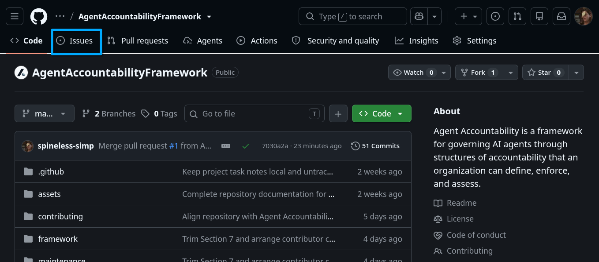
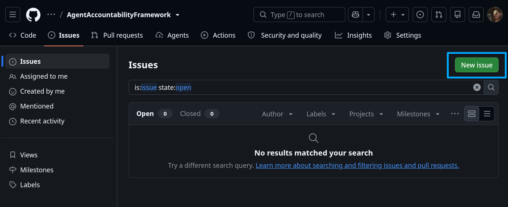

# Contributing to the Agent Accountability Framework

Corrections, reports of ambiguity, and framework change proposals are welcome; you do not need a complete solution to participate. Please follow the [Code of Conduct](CODE_OF_CONDUCT.md) in project spaces.

## How to contribute

### Ask a question or start a discussion

For a question about the framework or an open-ended conversation without a specific correction or change proposal, use [GitHub Discussions](https://github.com/AgentAccountabilityFramework/AgentAccountabilityFramework/discussions):

1. Open the repository's **Discussions** tab and check for an existing conversation on your topic.
2. Select **New discussion**. Choose **Q&A** for questions, **General** for open conversations, or **Ideas** to explore a possible improvement.
3. Add a descriptive title and your question or topic. Link the relevant framework passages and include enough context for others to respond, then select **Start discussion**.

If the conversation identifies a concrete correction or framework change, open an issue using the appropriate template and link back to the discussion. See GitHub's [discussion guide](https://docs.github.com/en/discussions/quickstart#creating-a-new-discussion) for the submission steps.

### First, create an issue

Start with an issue so the problem and proposed approach can be discussed before you prepare an edit. Reporting an issue does not commit you to fixing it. Identify the affected files and passages, including line numbers or control IDs where relevant, and explain what needs to change and why.

Read the relevant [framework source](source/v1.0/README.md) before proposing a change. See [proposing changes](contributing/proposing-changes.md) for guidance on evidence and effects on existing requirements.

1. Open the **Issues** tab in the repository navigation.

   

2. Select **New issue**.

   

3. Choose the template that fits your contribution:

   - **Documentation correction** — Report errors, unclear wording, broken links, or inaccuracies. Identify the passage and provide supporting evidence; suggested wording is optional.
   - **Framework change proposal** — Propose updates to scope, requirements, definitions, or other framework content. Explain the problem, intended outcome, affected sections or controls, and alternatives.

   You can also open a blank issue. Include the same information relevant to your correction or proposal.

4. Add a descriptive title and complete the relevant sections. Attach screenshots if they help show the problem. Leave assignees, labels, projects, and milestones to maintainers, then select **Create**.

Updates to the issue depend on your [GitHub notification settings](https://github.com/settings/notifications); see GitHub's [notification guide](https://docs.github.com/en/subscriptions-and-notifications/get-started/configuring-notifications) to configure delivery. You can report a problem without submitting the edit yourself.

**Discussions, issues, and pull requests are public. Do not include confidential information, personal data, or sensitive details.**

For general questions or matters that need a private conversation, email [admin@agentaccountabilityframework.org](mailto:admin@agentaccountabilityframework.org). Send conduct reports to this address too, following the [Code of Conduct](CODE_OF_CONDUCT.md#reporting-a-concern).

### Ask an AI agent to submit an issue

Give the agent the repository URL, the passage or files involved, and your description of the problem or proposed outcome. Ask it to read the relevant [framework source](source/v1.0/README.md), check for an existing issue, and use the [documentation correction](.github/ISSUE_TEMPLATE/documentation.md) or [framework change proposal](.github/ISSUE_TEMPLATE/proposal.md) template. Follow the [AI-assisted contributions guide](contributing/ai-assisted-contributions.md); you remain responsible for the issue and responses to reviewers.

For example:

> Prepare an issue in [repository URL] about [problem or proposed change]. Read the contribution guide and relevant source passages, check for an existing issue, and use the appropriate issue template. Include the affected files, passages or control IDs, supporting evidence, and proposed outcome. Keep proposed requirements distinct from the current framework. Show me the title and body for review before submitting. After I approve, submit the issue and return its URL. Leave assignees, labels, projects, and milestones unset.

Review the draft for accuracy and sensitive information before authorizing submission. The agent needs access to a GitHub account with permission to open the issue. If it cannot submit, use its reviewed title and body to create the issue yourself through the steps above.

### Open a pull request

Use a pull request to submit an edit for review. Link the issue that prompted the change; for a substantial proposal, discuss the approach there before preparing the edit.

1. Fork the repository if you do not have write access. Create a branch for your change, starting from the latest `master`, and keep unrelated edits separate. The [repository layout](REPOSITORY_LAYOUT.md) explains where content belongs.
2. Make your edits following the [editorial guide](contributing/editorial-guide.md). Review the [AI-assisted contributions guide](contributing/ai-assisted-contributions.md) if applicable. Compare affected framework text with the relevant source sections, complete controls, and definitions. Keep proposed framework changes distinct from current requirements; do not silently rewrite the source baseline.
3. Update [CHANGELOG.md](CHANGELOG.md) under **Unreleased**. Update [source coverage](maintenance/source-coverage.md) when framework pages change. Check links, anchors, and control references, then run these commands from the repository root:

   ```sh
   python3 scripts/check-docs.py
   git diff --check
   ```

   If you changed the checker, run its regression tests too. See the [checks guide](maintenance/checks.md) for instructions and limits.

4. Commit your changes and push the branch to your fork or the repository. In the original repository, open **Pull requests**, then **New pull request**. Set the base to this repository's `master` branch and compare it with your change branch. For a fork, select **compare across forks** and choose your fork and branch. Review the diff before submitting. GitHub's [fork pull request guide](https://docs.github.com/en/pull-requests/how-tos/create-pull-requests/creating-a-pull-request-from-a-fork) covers these controls.
5. Add a descriptive title and complete the [pull request template](.github/PULL_REQUEST_TEMPLATE.md). Link the issue, explain what changed and why, and identify affected source sections and controls. State whether the edit is a documentation clarification, a transcription correction, or a framework change proposal. Describe validation results and any limitations. Select **Create pull request** when ready for review, or open a draft if work remains.
6. Respond to review comments and push revisions to the same branch. Check the automated results and address failures related to your change. Maintainers may request revisions or decline a change; record the reasoning and any unresolved disagreement in the discussion.

Merging a repository edit does not by itself change the framework baseline or publish a new version. See [repository governance](GOVERNANCE.md) and the [release guide](maintenance/releases.md) for that distinction, consistent with [Section 8](source/v1.0/08-framework-governance.md).

The [license notice](LICENSE) describes the terms and scope of the framework license. Only submit material you have permission to contribute.
